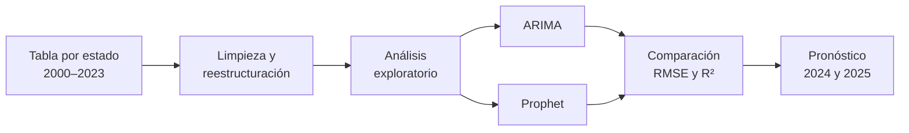

<p align="center">
  
  
  
  
  
</p>

# Predicción de diabetes en México, 2000–2025

Análisis de 24 años de registros de diabetes en los 32 estados de México y pronóstico para 2024 y 2025 con dos modelos de series de tiempo: **ARIMA** y **Prophet**. El objetivo es entender cómo ha crecido el problema y anticipar hacia dónde va, como apoyo para decisiones de salud pública.

## Resultados



| | ARIMA | Prophet |
| --- | :---: | :---: |
| Pronóstico 2024 | 15.75 millones | 15.17 millones |
| Pronóstico 2025 | 14.78 millones | **15.62 millones** |
| RMSE | 2.25 millones | **2.22 millones** |
| R² | 0.651 | **0.662** |

Se eligió **Prophet** como modelo final por su ajuste ligeramente mejor. Proyecta que 2025 cerrará en unos 15.6 millones de casos registrados, cerca del máximo histórico de 2023 (15.8 millones).

## Lo que muestran los datos

- **El total nacional se triplicó:** de 5.2 millones de registros en 2000 a 15.8 millones en 2023, un aumento del 205%.
- **Hay caídas abruptas.** La de 2020 coincide con la pandemia de COVID-19; también hay una en 2005–2006 y otra menor en 2014.
- **Los estados con más registros en 2023:** Estado de México (2.12 millones), Ciudad de México (1.88 millones), Nuevo León (1.34 millones), Jalisco (1.11 millones) y Veracruz (0.82 millones).

## Los datos

La fuente es la tabla «Detección de padecimientos. Diabetes» (`istabla43_2023.csv`), con un valor por entidad y por año de 2000 a 2023. A partir de ella se construyeron las demás bases del repositorio, incluida la tasa por cada 100 mil habitantes con la población de 2020.

## Cómo funciona



1. **Preparación.** La tabla original viene con un año por columna; se pasa a formato largo (estado, año, casos) y se agrega la población.
2. **Análisis exploratorio.** Tendencia nacional, comparación entre estados, mapas de calor y descomposición de la serie.
3. **ARIMA.** Modelo clásico que predice solo a partir de los valores pasados de la serie.
4. **Prophet.** Modelo de Meta que ajusta tendencias no lineales con puntos de cambio.
5. **Comparación.** Ambos se evalúan con RMSE y R² sobre la serie nacional y se conserva el mejor.

## Cómo ejecutarlo

```bash
git clone https://github.com/AnnaCUGA/PrediccionDiabetes_2024-2025.git
cd PrediccionDiabetes_2024-2025
pip install pandas matplotlib statsmodels prophet
jupyter notebook "Predicción_de_diabetes.ipynb"
```

## Estructura

```
Predicción_de_diabetes.ipynb                     Cuaderno con el análisis y los modelos
Reporte_predicción_de_diabetes.pdf               Reporte escrito del proyecto
Bases de datos/istabla43_2023.csv                Tabla original
Bases de datos/diabetes2000-2023.csv             Tabla con población agregada
Bases de datos/df_estados.csv                    Formato largo por estado, con tasa por 100 mil
Bases de datos/df_total.csv                      Serie nacional
Bases de datos/predicciones_2000_2025.csv        Datos históricos más pronósticos por estado
assets/                                          Gráficas de este README
```

## Limitaciones y siguientes pasos

- **La serie es corta:** 24 puntos anuales son pocos para un modelo de series de tiempo, y por eso los dos modelos quedan tan cerca.
- **Los modelos no explican las caídas** de 2005–2006 y 2020, que pesan mucho en el error. Con un R² de 0.66, el pronóstico sirve como tendencia, no como cifra exacta.
- **ARIMA y Prophet discrepan para 2025:** uno proyecta una baja y el otro un alza.
- **Las métricas se calcularon sobre los mismos años usados para ajustar.** Reservar los últimos años como prueba daría una evaluación más exigente.
- Incorporar variables externas (obesidad, alimentación, cobertura de detección) podría mejorar el modelo.

## Recomendaciones del reporte

1. Educación alimentaria desde edades tempranas.
2. Acceso amplio a la detección temprana, por ejemplo con clínicas móviles.
3. Fomento de la actividad física regular.

## Autora

Ana Cristina Cuevas García. Proyecto del curso Introducción a la Ciencia de Datos Aplicada a Escenarios Médico-Biológicos, Facultad de Ciencias, UNAM (semestre 2025-2). El detalle completo está en el [reporte](Reporte_predicción_de_diabetes.pdf).
